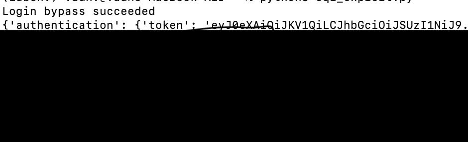
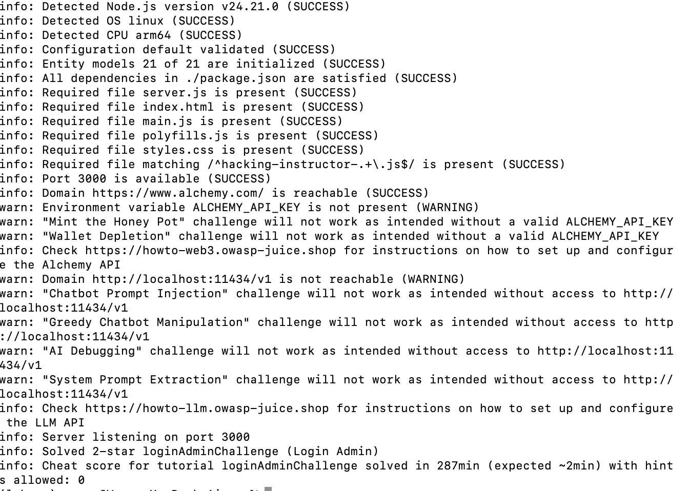

# Web Security Fundamentals: Port Scanning & SQL Injection

Hands-on lab to build the fundamentals from the ground up instead of just running tools
I don't fully understand. Built a TCP port scanner from scratch to see what Nmap is
actually doing, then manually exploited and scripted a SQL injection vulnerability
against OWASP Juice Shop, running locally in Docker.

## Motive

I'm a current cybersecurity engineer and grad student coming from a governance/RMF
background, and I wanted to build real offensive fundamentals instead of just reading
about them. I've spent most of my career on the assessment side — reading scan output,
not generating it. This lab was me forcing myself to understand *why* a scan or an
exploit works instead of trusting the tool to do it for me. Port scanning and SQLi felt
like the right starting point: foundational, well-documented, and directly relevant to
findings I already review in my day job.

## Environment

- Target: OWASP Juice Shop (`bkimminich/juice-shop`), Docker container, mapped to `localhost:8080`
- Tooling: Python 3 (stdlib `socket`, `requests`), Nmap
- Host: macOS

## Part 1 — Port Scanner

Wrote `port_scanner.py` as a basic TCP connect scanner instead of just running Nmap, to
understand the mechanics. A connect scan completes the full 3-way handshake (SYN →
SYN-ACK → ACK) against each port. Nmap's default SYN scan only sends the SYN and reads
the response without completing the handshake — faster, and the reason it needs root.

Scanned 8000-8100 with both:

    python3 port_scanner.py
    nmap -p8000-8100 localhost

**Result:** both found ports 8021 and 8080 open. 8080 is Juice Shop's mapped app port.
8021 I wasn't expecting — good reminder that containers expose more than the one port
you think you're testing, and scanning beats assuming scope.

## Part 2 — SQL Injection Login Bypass

Target: Juice Shop login form.

Payload: `' OR 1=1--` in the email field, anything in the password field.

**Why it works:** the backend is almost certainly building a query like:

    SELECT * FROM Users WHERE email = '<input>' AND password = '<hash>'

My input closes the string early, `OR 1=1` makes the WHERE clause always evaluate
true, and `--` comments out everything after it — including the password check. The
query returns a user row and the app hands back a valid session token. No password
was ever actually checked.

Maps to CWE-89 (SQL Injection), and to ATT&CK T1190 (Exploit Public-Facing Application)
in an internet-facing scenario.

Reproduced it twice, including after rebuilding the container from scratch with a fresh
database — confirms the bypass isn't tied to one specific seeded account, it's the
query logic itself.

## Part 3 — Scripting the Exploit

`sqli_exploit.py` hits Juice Shop's login API directly with the same payload, to see
what this looks like automated instead of done by hand in a browser.

**Result:** `Login bypass succeeded`, valid session token returned in the JSON response.
Confirms the API-level bypass matches what I did manually in the browser.

## Part 4 — What the Defender Sees

Pulled the container logs to see if the exploit left a visible trace:

    docker logs juiceshop --tail 50

**Result:** the payload and a success indicator both showed up. That's the raw signal
a detection rule would actually need to match on.

**Detection logic (written for Splunk, since that's what we use at work — this is
documentation, not a deployed rule):**

    index=web sourcetype=access_combined uri_path="*login*"
    | regex _raw="(?i)(or\s+1=1|union\s+select|--|;--)"
    | stats count by src_ip, uri_path

Flags login/auth requests containing SQL metacharacters or always-true boolean
patterns — the fingerprint this specific technique leaves behind.

## Issues I Ran Into

**Docker daemon wasn't running.** `docker` commands failed with a connection error
because Docker Desktop itself wasn't open — the CLI and the daemon are separate, and
the daemon has to be up first. Fixed by starting Docker Desktop and confirming with
`docker info`.

**Ran the script from the wrong directory.** `python3 port_scanner.py` threw
`No such file or directory` because I hadn't saved the file yet / was in a different
folder than where it lived. Checked with `pwd`/`ls` before running anything after that.

**Scanned the wrong port range.** My first scan used the default 1-1024 range, which
didn't cover Juice Shop's actual ports (8021, 8080). No error, just an empty result —
looked like a failed scan but was actually a correctly-run scan of the wrong range.
Fixed by scoping it to 8000-8100.

**`ModuleNotFoundError: No module named 'requests'`.** Homebrew's Python is
"externally managed" under PEP 668 and blocks global pip installs. Fixed properly
instead of forcing it — built a venv (`python3 -m venv labenv`) and installed
`requests` inside that, rather than overriding the system Python.

**Container got removed instead of just stopped.** Paused the lab at one point,
came back, and `docker start juiceshop` failed because I'd removed the container
earlier rather than stopping it. Had to recreate it with `docker run` from scratch.
Now I check `docker ps -a` first before assuming `start` will work.

## Next Steps

- Build out an AD environment for lateral movement and credential attacks
  (Kerberoasting, BloodHound), with a detection written for each technique — same
  attack/detect pairing as here, just a bigger environment.
- Add a second vulnerability class (stored XSS) for comparison.
